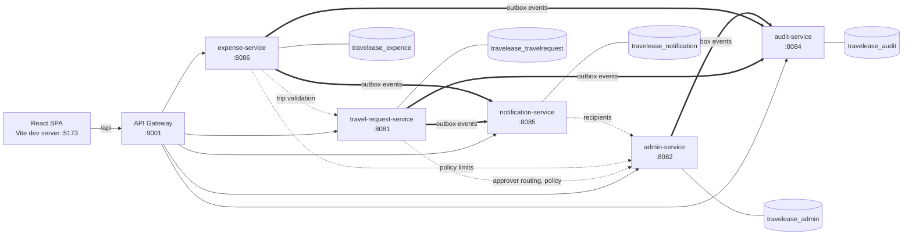

# TravelEase

**Corporate travel and expense management, built as Spring Boot microservices behind an API gateway, with a React and TypeScript frontend.**

Employees request business trips and claim expenses with receipts. Managers approve travel, Finance reviews and reimburses claims, and administrators manage users, reporting lines and spending policy. Every step is role-checked and audited, and the people who need to act are notified.


## Highlights

- **Microservices:** five Spring Boot services behind Spring Cloud Gateway, each owning its MySQL schema, with shared code in a common library.
- **Authorization:**
  - JWT authentication with role checks plus record-level rules, for example "only the assigned approver decides" and "no one approves their own request".
  - Service-to-service calls are signed with a separate secret.
- **Reliable events:** a transactional outbox writes audit and notification events in the same transaction as the business change and delivers them with retries. Consumers ignore duplicate deliveries.
- **Schema management:** Flyway migrations, with Hibernate in validate-only mode.
- **Consistent errors:** one shared exception handler maps validation, conflict, authorization and upload errors to structured 4xx responses.
- **Automated tests:** JUnit, Mockito and Spring integration tests, with H2 standing in for MySQL. Vitest and React Testing Library cover the frontend. A failing test fails the build.

## Features

| Area | What is implemented |
|---|---|
| **Travel requests** | Create, edit and submit. Resubmit after rejection. Cancel a pending trip, or an approved trip before it starts. Upload and download documents. |
| **Approvals** | Routed to the employee's manager, with a Finance fallback for top-level managers. Only the assigned approver may decide, and never on their own request. Admins can reassign pending approvals. |
| **Expense claims** | Raised against approved trips. Drafted, receipts attached, then submitted. Receipts are required above each category's threshold. Possible duplicates are flagged. Rejected claims can be corrected and resubmitted. |
| **Finance** | Review queue, approve or reject with a reason, mark reimbursed. Nobody can review or reimburse their own claim. |
| **Administration** | Users and roles, employee–manager mappings, expense categories and limits, travel document policy, password resets. |
| **Audit log** | Immutable trail of workflow and administrative changes. Finance sees the workflow trail; administrative records are visible to admins only. |
| **Notifications** | In-app notifications with a paged list and unread badge. Optional e-mail over SMTP, off by default. |
| **Accounts and sessions** | Password change, forced change after an admin reset, password policy, sign-in rate limiting, and a session-expiry warning with in-place re-authentication. |
| **UI** | Role-based dashboards and navigation, paginated and sortable tables, CSV export of travel and expense lists, light and dark themes. |

## Architecture



**Legend:** solid arrows are client requests, dotted arrows are synchronous service-to-service calls, and thick arrows are asynchronous events. Each service owns its own schema.

| Service | Port | Schema | Responsibility |
|---|---|---|---|
| `gateway-service` | 9001 | – | Single entry point: routing and CORS |
| `travel-request-service` | 8081 | `travelease_travelrequest` | Travel requests, approvals, travel documents |
| `admin-service` | 8082 | `travelease_admin` | Sign-in and JWT issuing, users, roles, mappings, policies |
| `audit-service` | 8084 | `travelease_audit` | Immutable audit trail |
| `notification-service` | 8085 | `travelease_notification` | In-app notifications, optional e-mail |
| `expense-service` | 8086 | `travelease_expence` | Expense claims, review, reimbursement, receipts |
| `common-lib` | – | – | Shared errors, security, document storage, transactional outbox |

### Public API routes (gateway)

| Path | Service |
|---|---|
| `/api/travel-requests/**` | travel-request-service |
| `/api/expenses/**` | expense-service |
| `/api/admin/**`, `/api/auth/login`, `/api/auth/change-password`, `/api/auth/complete-password-change` | admin-service |
| `/api/audit/**` | audit-service |
| `/api/notifications/**` | notification-service |

The gateway does not route internal endpoints (`/internal/**`, `/api/events`). Those accept only signed service tokens.

## Tech stack

| Layer | Technologies |
|---|---|
| Backend | Java 17, Spring Boot 3.2, Spring Web, Spring Data JPA, Spring Security (OAuth2 resource server, JWT), Bean Validation, Spring Mail |
| Gateway | Spring Cloud Gateway 2023.0 |
| Data | MySQL 8, Flyway |
| Frontend | React 19, TypeScript, Vite, React Router, React Hook Form, Zod, Axios |
| Testing | JUnit 5, Mockito, Spring Boot Test, H2, GreenMail, Vitest, React Testing Library |
| Build and CI | Maven multi-module, npm, Jenkins (`Jenkinsfile`) |

## Project structure

```text
.
├── backend/
│   ├── pom.xml                    # Maven parent for all modules
│   ├── .env.example               # Environment template (placeholders only)
│   ├── common-lib/                # Shared library used by every service
│   ├── gateway-service/
│   ├── admin-service/
│   ├── travel-request-service/
│   ├── expense-service/
│   ├── audit-service/
│   ├── notification-service/      # each service: src/main/resources/db/migration (Flyway)
│   └── scripts/verify-migrations.sh
├── frontend/                      # React + TypeScript app (Vite)
│   └── src/                       # pages, components, hooks, services, routes
├── generate-token.js              # Development-only JWT helper, with tests
└── Jenkinsfile                    # CI: backend build and tests, frontend lint, tests and build
```

## Getting started

### Prerequisites

- JDK 17 or later
- Maven 3.9 or later
- Node.js 20.19 or later (required by Vite 8)
- MySQL 8

### 1. Configure the environment

```bash
cp backend/.env.example backend/.env
```

The five business services read `backend/.env` automatically (it is git-ignored); the gateway needs no secrets. Set at least these values:

| Variable | Purpose |
|---|---|
| `TRAVELEASE_DB_USERNAME`, `TRAVELEASE_DB_PASSWORD` | MySQL account used by the services |
| `TRAVELEASE_JWT_SECRET` | Signs and verifies user tokens (at least 32 random bytes) |
| `TRAVELEASE_INTERNAL_SECRET` | Signs service-to-service calls; must differ from the JWT secret |

Generate each secret with `openssl rand -base64 48`.

<details>
<summary>Optional settings</summary>

| Variable | Default | Purpose |
|---|---|---|
| `TRAVELEASE_DB_HOST`, `TRAVELEASE_DB_PORT` | `localhost`, `3306` | MySQL location |
| `TRAVELEASE_STORAGE_DIR` | `~/.travelease/documents` | Where uploaded documents are stored |
| `ADMIN_SERVICE_INTERNAL_URL`, `ADMIN_SERVICE_API_URL`, `TRAVEL_REQUEST_SERVICE_API_URL` | local ports | Service-to-service URLs |
| `AUDIT_EVENTS_URL`, `NOTIFICATION_EVENTS_URL` | local ports | Event delivery targets |
| `TRAVELEASE_BOOTSTRAP_ADMIN_EMAIL`, `TRAVELEASE_BOOTSTRAP_ADMIN_PASSWORD` | unset | Creates the first administrator on an empty database |
| `TRAVELEASE_EMAIL_ENABLED`, `TRAVELEASE_SMTP_*`, `TRAVELEASE_EMAIL_FROM` | e-mail off | Optional e-mail notifications |
| `GATEWAY_ALLOWED_ORIGINS` | `http://localhost:5173,http://localhost:5174` | Gateway CORS origins |

</details>

### 2. Prepare the database

Create a dedicated MySQL account and the five schemas, replacing `<password>` with your own value:

```sql
CREATE USER 'travelease_app'@'localhost' IDENTIFIED BY '<password>';

CREATE DATABASE travelease_admin;
CREATE DATABASE travelease_travelrequest;
CREATE DATABASE travelease_expence;
CREATE DATABASE travelease_audit;
CREATE DATABASE travelease_notification;

GRANT ALL PRIVILEGES ON travelease_admin.*         TO 'travelease_app'@'localhost';
GRANT ALL PRIVILEGES ON travelease_travelrequest.* TO 'travelease_app'@'localhost';
GRANT ALL PRIVILEGES ON travelease_expence.*       TO 'travelease_app'@'localhost';
GRANT ALL PRIVILEGES ON travelease_audit.*         TO 'travelease_app'@'localhost';
GRANT ALL PRIVILEGES ON travelease_notification.*  TO 'travelease_app'@'localhost';
```

Tables are created by **Flyway** when each service starts, from `src/main/resources/db/migration`. Hibernate only validates the schema (`ddl-auto: validate`).

- **Existing database** created before migrations were introduced: Flyway baselines it and applies the later scripts. Back it up first.
- **Rehearsal:** `backend/scripts/verify-migrations.sh` rehearses the migrations on throwaway schemas. It needs `VERIFY_DB_USERNAME` and `VERIFY_DB_PASSWORD`.

### 3. Start the backend

Build once from `backend/`. This also installs `common-lib`, which every service depends on:

```bash
cd backend
mvn -B install -DskipTests
```

Then start each service in its own terminal from `backend/`, admin-service first:

```bash
mvn -pl admin-service spring-boot:run
mvn -pl audit-service spring-boot:run
mvn -pl notification-service spring-boot:run
mvn -pl travel-request-service spring-boot:run
mvn -pl expense-service spring-boot:run
mvn -pl gateway-service spring-boot:run
```

Each service reports its status at `http://localhost:<port>/actuator/health`.

**Signing in for the first time:**

- **Sample data:** start admin-service, travel-request-service and expense-service with `SPRING_PROFILES_ACTIVE=dev`. They seed sample accounts, trips and claims into empty databases. `TRAVELEASE_SEED_PASSWORD` (the sample-account password) is required; seeding refuses to run without it.
- **Clean start:** set `TRAVELEASE_BOOTSTRAP_ADMIN_EMAIL` and `TRAVELEASE_BOOTSTRAP_ADMIN_PASSWORD`. admin-service creates one administrator, who must change the password at first sign-in. Remove both variables afterwards.

### 4. Start the frontend

From the repository root:

```bash
cd frontend
npm ci
npm run dev
```

Open <http://localhost:5173>. The dev server proxies `/api` to the gateway at `http://127.0.0.1:9001`; set `VITE_GATEWAY_URL` to use another address.

## Testing

Run from the repository root:

```bash
# Backend: unit, web-slice and integration tests (in-memory H2, no MySQL needed) and coverage checks
(cd backend && mvn -B clean verify)

# Frontend: lint, tests, type-check and production build
(cd frontend && npm ci && npm run lint && npm run test:run && npm run build)

# Development token helper
node --test generate-token.test.js
```

Test failures fail the Maven build. The `Jenkinsfile` runs the backend and frontend stages and publishes JUnit reports.

## Security and configuration

- **Configuration by environment:** database, JWT, service and SMTP credentials are read from environment variables; `backend/.env.example` contains placeholders only, and test configuration uses clearly marked test-only values.
- **Production checks:** with `SPRING_PROFILES_ACTIVE=prod`, a service refuses to start in any of these cases:
  - A secret is missing, weak, published or reused.
  - The database uses default credentials.
  - Sample-data seeding is enabled.
  - Document storage is not set to an explicit absolute path.
  
  The prod profile also exposes only `/actuator/health` and hides error details.
- **Token revocation:** changing a user's password, roles or active status invalidates that user's existing tokens in admin-service. Other services rely on the 60-minute token expiry.
- **Sign-in rate limiting** is held in memory per admin-service instance.
- **E-mail notifications** stay disabled until real SMTP settings are supplied.

## Where to look in the code

| Concern | Implementation |
|---|---|
| Approval rules and travel workflow | [`TravelRequestServiceImpl`](backend/travel-request-service/src/main/java/com/travelease/travelrequest/service/impl/TravelRequestServiceImpl.java) |
| Approver routing and Finance fallback | [`EmployeeManagerRoutingServiceImpl`](backend/admin-service/src/main/java/com/travelease/admin/service/impl/EmployeeManagerRoutingServiceImpl.java) |
| Expense ownership, draft and submit, receipt rule | [`ExpenseClaimServiceImpl`](backend/expense-service/src/main/java/com/travelease/expense/service/impl/ExpenseClaimServiceImpl.java) |
| Finance review and reimbursement | [`ExpenseReviewServiceImpl`](backend/expense-service/src/main/java/com/travelease/expense/service/impl/ExpenseReviewServiceImpl.java) |
| Transactional outbox | [`OutboxEventWriter`](backend/common-lib/src/main/java/com/travelease/common/outbox/OutboxEventWriter.java), [`OutboxDispatcher`](backend/common-lib/src/main/java/com/travelease/common/outbox/OutboxDispatcher.java) |
| Service-to-service authentication | [`InternalServiceSecurity`](backend/common-lib/src/main/java/com/travelease/common/security/internal/InternalServiceSecurity.java) |
| Production safety checks | [`ProductionSafetyEnvironmentPostProcessor`](backend/common-lib/src/main/java/com/travelease/common/config/ProductionSafetyEnvironmentPostProcessor.java) |
| Shared API error handling | [`ApiExceptionHandler`](backend/common-lib/src/main/java/com/travelease/common/web/ApiExceptionHandler.java) |
| Gateway routes | [`gateway-service/application.yml`](backend/gateway-service/src/main/resources/application.yml) |
| Frontend routes and roles | [`routeTable.ts`](frontend/src/routes/routeTable.ts) |
| Session-expiry handling | [`SessionExpiryWarning.tsx`](frontend/src/components/session/SessionExpiryWarning.tsx) |
